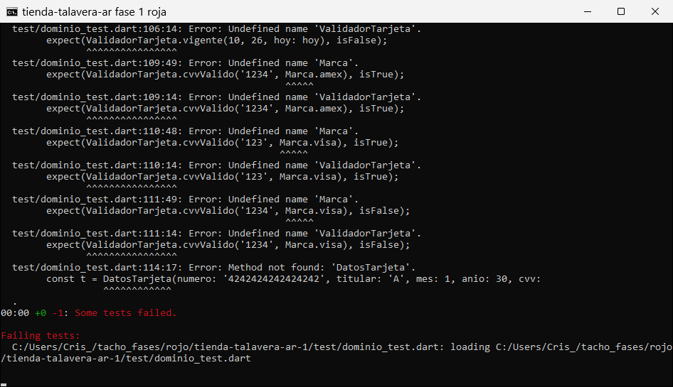
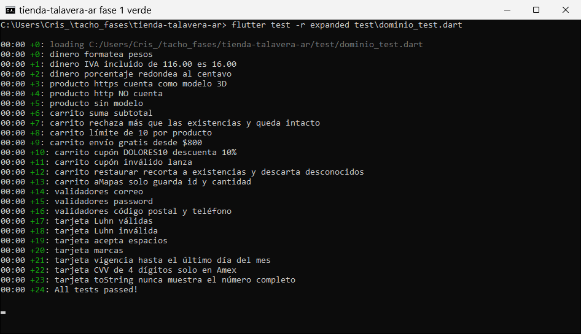
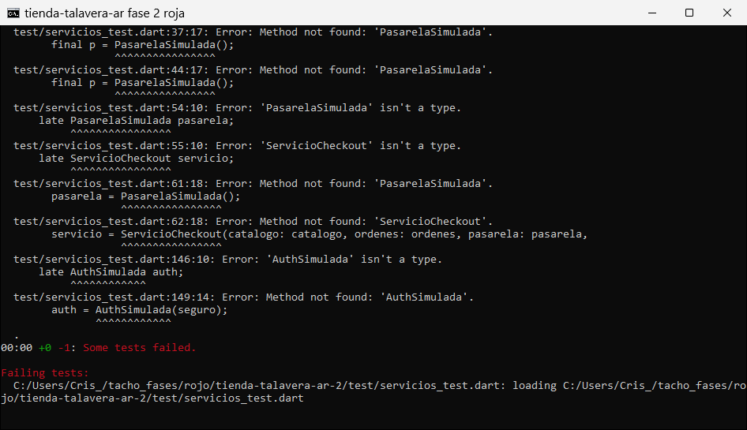
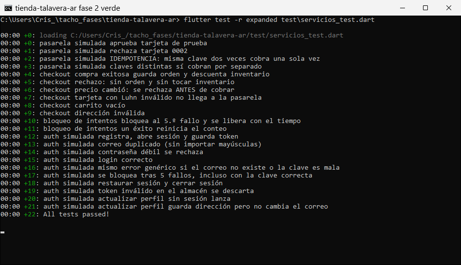
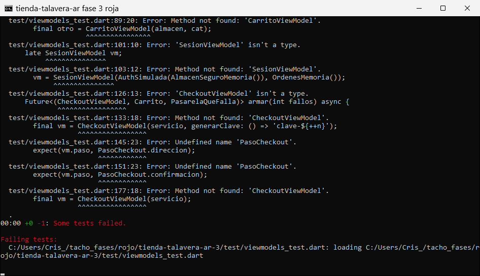
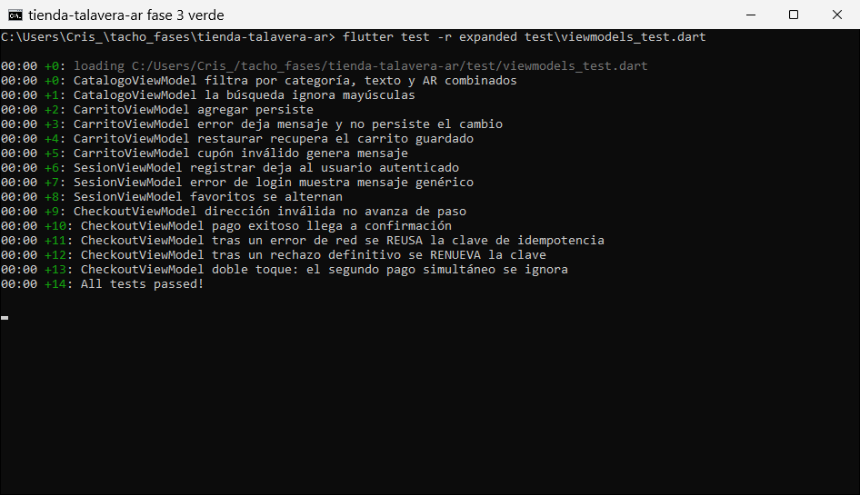
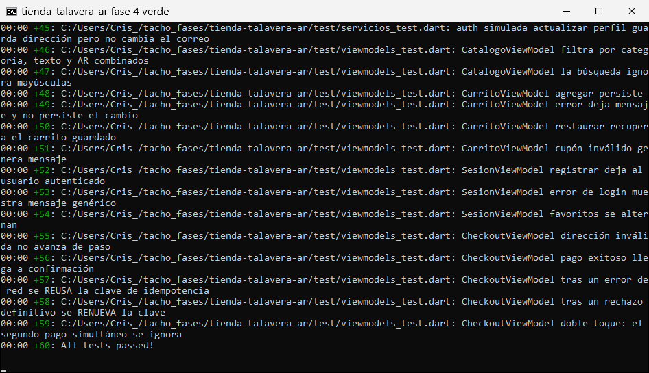

# Talavera Dolores: tienda móvil con realidad aumentada

Tienda de artesanías de Dolores Hidalgo hecha en Flutter con TDD: catálogo, carrito, cupones, pagos simulados, cuentas de usuario y "Ver en tu espacio" con realidad aumentada (`model_viewer_plus`). Sigue el *Manual paso a paso con TDD: Talavera Dolores*.

```
lib/
  dominio/        reglas del negocio (Dart puro): dinero, producto, carrito, validadores,
                  tarjeta, orden, excepciones, contratos, servicio_checkout, bloqueo_intentos
  datos/          catálogo en memoria, almacenes, pasarela simulada, auth simulada
  presentacion/   vm/ (ViewModels) y pantallas/
  dependencias.dart, main.dart
test/  dominio_test, servicios_test, viewmodels_test
```

## Fase 1. Dominio: dinero, producto, carrito y tarjeta

El dinero se guarda en centavos enteros. El carrito limita a 10 piezas por producto, respeta las existencias, aplica cupones (`DOLORES10`, `TALAVERA15`) y da envío gratis desde $800. La tarjeta se valida con el algoritmo de Luhn y nunca se imprime completa.

Pruebas (`test/dominio_test.dart`):

1. Formato de pesos, IVA incluido y porcentaje redondeado al centavo.
2. Solo `https://` o `assets/` cuentan como modelo 3D.
3. Subtotal, límite de existencias, máximo 10 por producto y envío gratis desde $800.
4. Cupón válido e inválido; restaurar el carrito recorta a existencias.
5. Validadores de correo, contraseña, código postal y teléfono.
6. Luhn, marcas (Visa, Mastercard, Amex), vigencia, CVV y `toString` seguro.

### Fase roja

La prueba falla porque todavía no existen el carrito ni el validador de tarjetas.



### Fase verde

Se agregan `dinero.dart`, `producto.dart`, `excepciones.dart`, `carrito.dart`, `validadores.dart` y `tarjeta.dart`. Todas las pruebas de dominio pasan.



## Fase 2. Servicios: pasarela, checkout y cuentas

La pasarela simulada respeta la idempotencia (la misma clave nunca cobra dos veces). El checkout revalida precios y existencias antes de cobrar y solo descuenta inventario si el pago se aprueba. Las cuentas guardan sal + hash, usan un mensaje de error genérico y se bloquean tras 5 intentos.

Pruebas (`test/servicios_test.dart`):

1. La pasarela aprueba la tarjeta de prueba y rechaza la `...0002`.
2. Idempotencia: misma clave cobra una sola vez; claves distintas cobran por separado.
3. Compra exitosa guarda la orden y descuenta inventario; un rechazo no toca nada.
4. Precio cambiado, Luhn inválido, carrito vacío y dirección inválida se detienen antes de cobrar.
5. Bloqueo de intentos y su liberación con el tiempo.
6. Registro, login, mensaje genérico, bloqueo, sesión y perfil.

### Fase roja

La prueba muestra el error antes de implementar la pasarela, el checkout y la autenticación.



### Fase verde

Se agregan `pasarela_simulada.dart`, `servicio_checkout.dart`, `bloqueo_intentos.dart`, `auth_simulada.dart`, `almacenes.dart` y `catalogo_memoria.dart`. Todas las pruebas de servicios pasan.



## Fase 3. ViewModels

Cada ViewModel (`ChangeNotifier`) conecta las pantallas con el dominio: filtros del catálogo, carrito persistente, sesión y checkout de tres pasos con protección contra doble toque.

Pruebas (`test/viewmodels_test.dart`):

1. El catálogo combina categoría, texto y "solo AR"; la búsqueda ignora mayúsculas.
2. El carrito persiste, muestra mensajes de una sola lectura y se restaura.
3. La sesión registra, muestra el error genérico y alterna favoritos.
4. El checkout no avanza con dirección inválida, confirma el pago, reusa la clave tras un error de red, la renueva tras un rechazo e ignora el doble toque.

### Fase roja

La prueba falla mientras todavía no existen los ViewModels.



### Fase verde

Se agregan `catalogo_vm.dart`, `carrito_vm.dart`, `sesion_vm.dart` y `checkout_vm.dart`. Todas las pruebas de ViewModels pasan.



## Fase 4. Todas las pruebas

Con las pantallas (catálogo, detalle, "Ver en tu espacio", carrito, checkout y perfil) y la raíz de composición (`dependencias.dart`), se corre `flutter test` completo.



## Cómo probarla

```
flutter pub get
flutter test
flutter run
```

Tarjeta de práctica: `4242 4242 4242 4242`, cualquier fecha futura y CVV `123`. La `4000 0000 0000 0002` siempre se rechaza. La pasarela y el servidor de cuentas son simulados: nunca se procesa dinero real. "Ver en tu espacio" abre el visor 3D en el emulador; la realidad aumentada necesita un teléfono compatible con ARCore.

## Resultado

Las tres capas del proyecto se construyeron con el ciclo rojo → verde, con su evidencia en cada fase y la corrida final de todas las pruebas.
